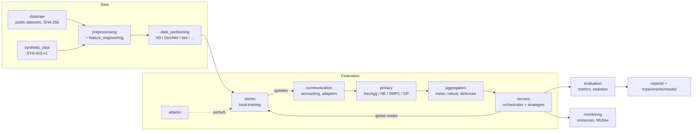

# Federated Learning Security
Simulated federated learning: what secure aggregation costs and what it misses

<!-- Row 1: Project and licence (6 badges) -->
 
 
 
 
 


<!-- Row 2: Technology stack (7 badges) -->
 
 
 
 
 
 


<!-- Row 3: Security and privacy (6 badges) -->
 
 
 
 
 


<!-- Row 4: Quality and CI (4 static badges; GitHub Actions placeholders below) -->
 
 
 


<!-- GitHub Actions status badges (replace <OWNER>/<REPO> with actual repo) -->
<!--  -->
<!--  -->
<!--  -->

<!-- Row 5: Reproducibility and research (5 badges) -->
 
 
 
 


<!-- Navigation bar (centred) -->
- [Architecture](docs/architecture.md) [Defences](docs/defenses.md) [Threat analysis](docs/threat_analysis.md) [Reproducibility](docs/reproducibility.md) [Manuscript PDF](latex/manuscript_ieee.pdf) [Notebooks](notebooks/)

---
# Federated Learning Security — research platform

A simulated federated-learning (FL) platform for studying **secure aggregation, privacy, attacks and defences** with reproducible data pipelines, tests and notebooks. Two execution modes share the same strategies, aggregators and client training code: an **in-process simulator** (`run_fl`, virtual clients, used for the experiments) and a **real networked federation** (a server process and separate client processes over TCP with mutual TLS, tested on localhost). There is no real hospital data and no compliance claim.

**Author:** Guy M. Kaptue T. · [github.com/GuyKaptue](https://github.com/GuyKaptue/) · guykaptue24@gmail.com

## Objectives
1. Implement and compare FL algorithms (FedAvg, FedProx, SCAFFOLD, FedNova) behind a clean client / server / strategy / aggregator separation.
2. Measure the cost of confidentiality mechanisms (homomorphic encryption, Bonawitz-style secure aggregation, SPDZ-style SMPC) and differential privacy.
3. Evaluate attacks (backdoor, Byzantine, membership inference, gradient inversion, adaptive aggregation-aware attackers) and defences (median, trimmed mean, Krum, clipping, anomaly filtering).
4. Provide a documented, reproducible data layer: a fully synthetic benchmark (SYN-IDS-v1) and four public healthcare datasets with checksummed downloads.
5. Keep every reported number traceable to a stored result file, with limitations stated.

## Architecture


Key design decisions are in [docs/architecture.md](docs/architecture.md).

## Repository structure
```
src/federated_learning/   clients/ servers/ aggregators/ strategies/ communication/ privacy/ attacks/
                          synthetic_data/ data_partitioning/ preprocessing/ feature_engineering/
                          training/ evaluation/ explainability/ causal_inference/ (scaffold) monitoring/
                          utils/ pipelines/
configs/                  training.yaml federated.yaml synthetic_data.yaml model.yaml privacy.yaml
data/                     raw/<dataset>/  processed/  synthetic/{syn_ids_v1,generated,validation,metadata}  external/
notebooks/                01_dataset_overview … 14_publication_figures  (+ sprint_tasks/ per-task notebooks)
experiments/              results/ (stored full-scale results)  mlruns/ (MLflow store, git-ignored)
reports/                  figures/  notebooks/  manuscript_support/  sprint/
models/                   model registry (weights + model card)
docs/                     architecture.md  datasets/  jira/  research/  references/
tests/                    unit/  integration/  end_to_end/
scripts/                  documentation, notebook, manuscript and packaging generators
latex/                    IEEEtran manuscript (PDF + sources)
.github/workflows/        ci.yml  security.yml  packaging.yml
```

## Installation
```bash
python -m venv .venv && source .venv/bin/activate
pip install -r requirements.txt          # pinned versions used for the study
pip install -e . --no-deps               # makes `federated_learning` importable
pip install -r requirements-dev.txt      # tests, lint, security, packaging tools
```
Without installing, use `PYTHONPATH=src`. CPU only; no GPU needed.

## Quick start
```python
from federated_learning.synthetic_data import make_dataset
from federated_learning.data_partitioning import partition
from federated_learning.servers.orchestrator import run_fl
from federated_learning.training import load_fl_config

data = make_dataset(n_samples=6000, seed=0)
parts = partition("dirichlet", data.y_train, n_clients=10, seed=0, alpha=0.5)
result = run_fl(load_fl_config({"algo": "fedprox", "mu": 0.05, "rounds": 15}), data, parts)
print(result.final["acc"])
```
```bash
make test            # full test-suite
make notebooks       # regenerate + execute the 14 numbered notebooks
```

## Data pipeline
Raw files are fetched on demand into `data/raw/<dataset>/` over HTTPS and **refused unless their SHA-256 matches the registry** (`preprocessing/registry.py`). Loaders recode missing-value codes, remove duplicates, split 70/30 stratified, and fit imputation/standardisation on the **training split only**.

## Datasets
<!-- dataset-table:start -->
| Dataset | Samples | Features | Positive rate | Source | License | Federated setup | Purpose in experiments |
|---|---|---|---|---|---|---|---|
| SYN-IDS-v1 (synthetic) | 12000 | 40 | 0.402 | generated (scikit-learn) | n/a (generated, no restrictions) | simulated IID / Dirichlet / shard clients | FL benchmarks, crypto overhead, secure aggregation, attacks, defences, scalability, HPO |
| Breast Cancer Wisconsin (Diagnostic) | 569 | 30 | 0.627 | UCI, via scikit-learn (bundled) | CC BY 4.0 | simulated IID / Dirichlet clients | validation on real, de-identified tables |
| Pima Indians Diabetes | 768 | 8 | 0.349 | public GitHub mirror (original: NIDDK) | not verified (no licence statement found; mirror unknown) | simulated IID / Dirichlet clients | validation on real, de-identified tables |
| Heart Disease, Cleveland (processed) | 302 (303 raw, 1 duplicate removed) | 13 | 0.543 | UCI, via public GitHub mirror | CC BY 4.0 (original UCI dataset); mirror unverified | simulated IID / Dirichlet clients | validation on real, de-identified tables |
| UCI Heart Disease, four sites | 920 | 10 | 0.553 | UCI / public GitHub mirror (pinned commit) | CC BY 4.0 (original); mirror unverified | 4 natural site clients (Cleveland, Hungary, Switzerland, VA Long Beach) | natural heterogeneity; within-site and leave-one-site-out validation |
<!-- dataset-table:end -->

Details, checksums and licences: [docs/datasets/dataset_catalog.md](docs/datasets/dataset_catalog.md).

* **SYN-IDS-v1 is completely synthetic despite its name** (scikit-learn `make_classification`): not real intrusion data, not patient data.
* No real hospital data is used and no patient-identifiable data exists anywhere in the project.
* All federated clients are simulated locally.
* Raw source datasets are not redistributed. Some are fetched from public third-party mirrors; original licences are documented where we could read them (the mirrors' own licences were not verified; Pima has no verified licence).
* CIC-IDS-2017 was not available and is not used.
* No credentialed clinical repository (e.g. PhysioNet MIMIC-IV, eICU) was available; none is used in the paper or the code.

## Synthetic data workflow
```bash
PYTHONPATH=src python -m federated_learning.synthetic_data.pipelines --seed 0
```
generate → validate against the specification → quality report (duplicates, correlation, linear-probe AUC) → train/test drift (PSI) → dataset card with the SHA-256 of the arrays (`data/synthetic/{syn_ids_v1,validation,metadata}`). Parameters live in `configs/synthetic_data.yaml`.

## Federated learning workflow
`configs/*.yaml` → `load_fl_config` → partition (`data_partitioning.partition`) → `run_fl`: each round the **strategy** chooses the client proximal term / control variates, **clients** train locally, an optional **attack hook** perturbs updates, an **aggregator** (optionally a secure-aggregation protocol) combines them, and the strategy applies the server step → evaluation each round. Strategies and aggregators are interchangeable; see `FederatedClient`, `Strategy`, `Aggregator`.

`communication.NumPyClientAdapter` exposes the `get_parameters / fit / evaluate` surface of Flower's `NumPyClient`. It is **duck-typed only: it has not been run against Flower, TensorFlow Federated or FedML.**

## Networked federation (real sockets, mutual TLS)
```bash
PYTHONPATH=src python scripts/run_network_demo.py --clients 5 --rounds 10   # 1 server + 5 client OS processes on localhost
```
`servers/network_server.py` (`FederatedServer`) and `clients/network_client.py` (`NetworkClient`) exchange length-prefixed frames (`communication/protocol.py`, size limits checked before allocation) over TLS ≥ 1.2 with **client certificates**: the certificate CN must be `client-<id>` and match the claimed id, otherwise the connection is rejected. Slow or invalid clients are dropped and the round continues if `min_clients` answered. `communication/tls.py` generates a throw-away demo PKI. With the same configuration the networked run produces **bit-identical weights** to the simulator (tested for FedAvg, FedProx, SCAFFOLD, FedNova; a tampering client behaves as in the simulator up to float32 rounding). Wire bytes are measured on the sockets.

Not covered: WAN conditions (latency, loss, NAT), certificate lifecycle/revocation, rate limiting, Sybil-resistant enrollment, a distributed secure-aggregation message flow between clients (aggregators such as SecAgg still run inside the server on updates received over TLS), `hetero_epochs`, and any run against Flower/TFF/FedML. Plaintext mode exists only behind an explicit `allow_insecure` flag.

## Stage-1 additions: federated preprocessing, calibration, sensitivity grids
```bash
PYTHONPATH=src python -m federated_learning.pipelines.experiments.run_all --task FL-S1   # FL-S1-001/002/003 (~30 min on 2 cores)
```
* `preprocessing/federated_scaler.py` - global mean / standard deviation (NaN-aware, mean imputation) from **two secure-aggregation rounds**; no raw row is pooled. Matches the pooled statistics to ~1e-10 (fixed-point precision). The server still learns the aggregate; no DP; a malicious client can distort the sums; the original pooled-**median** imputation is not a sum and cannot be reproduced this way.
* `evaluation/calibration.py` - Brier score, ECE (15 equal-width bins), reliability curves.
* `FL-S1-001` preprocessing regimes (pooled oracle / federated / local / none) on SYN-IDS-v1 with injected per-client measurement shift and on the four natural heart-disease sites; `FL-S1-002` calibration of FedAvg/FedProx/SCAFFOLD/FedNova; `FL-S1-003` one-factor grids over malicious fraction, Dirichlet alpha, participation and model size. Results: `experiments/results/fl_stage1/`. All with CIs, paired effect sizes (d_z, Cliff's delta) and Holm-corrected Wilcoxon p-values.
* Honest scope: simulations with virtual clients on synthetic or small public data; **no credentialed clinical repository (PhysioNet MIMIC-IV / eICU) is used**.

## Stage-2 additions: literature defences and model baselines
* `aggregators/literature_defenses.py` - FLAME, robust learning rate, FoolsGold, SignGuard re-implemented from the papers (references verified; choices and omissions in `docs/defenses.md`). They are research re-implementations on a small MLP, not guaranteed to reproduce published numbers.
* `training/models.py` - `arch="logreg" | "mlp" | "deep_mlp"` (`FLConfig.arch`, default unchanged).
* Experiments `FL-S2-001/002/003` (`experiments/results/fl_stage2/`): twelve rules x untargeted / backdoor / adaptive attackers with TPR/FPR, label-skew cost, architecture baselines. Attackers are omniscient upper bounds; the only decorrelation is the `jitter` option; see the E3 section below for what it showed against FoolsGold.

## Stage-3 additions: randomised rule committee and attacker-knowledge ladder
* `aggregators/committee.py` - `RuleCommittee`: a (random) subset of rules {anomaly filter, Multi-Krum, FLAME, SignGuard} votes on which rows to reject; fail-open to the coordinate median. Randomised or hybrid aggregation is **not new** (Nabavirazavi et al. 2023; Yue et al. 2024); what this repository adds is a measured study, not a new principle.
* `attacks/adaptive.py` - attacker knowledge `draw` (knows the private draw) vs `pool` (knows only the pool) and a `jitter` option that decorrelates the colluders' rows.
* Experiments `FL-S3-001/002/003` (`experiments/results/fl_stage3/`): committee variants vs seven baselines, TPR/FPR, ablations over k, vote rule and attacker fraction. Reduced scale (5 seeds, 15 rounds, 8000 samples; 4 seeds for ablations).
* `docs/threat_analysis.md` - threat model and two elementary propositions with explicit limits (no security proof). Omniscient upper-bound attackers, synthetic data only.

## Adaptive-attacks work package, E3 (similarity-based Sybil defences)
* Research documents live with the rest of the adaptive-attacks work in `docs/research/adaptive_attacks/` (`e3_*.md`, `foolsgold_*.md`; start with `e3_phase4a_completion_report.md`).
* Code: `aggregators/foolsgold_indicative.py` (FoolsGold with indicative-feature weighting, a documented adaptation because the paper gives no formula for S_t; the legacy `FoolsGold` is unchanged; `make_defence("foolsgold_corrected")` in `pipelines/experiments/stage2.py` returns the all-feature variant with the ln(0) defect fixed, registered but not used by any default experiment), `pipelines/experiments/e3.py` (`FL-E3-BASE`, 10-seed baseline) and `e3_fg.py` (`FL-E3-FGVAL`, legacy vs paper-faithful FoolsGold). Outputs: `outputs/research/adaptive_attacks/e3/`.
* Run: `PYTHONPATH=src python -m federated_learning.pipelines.experiments.run_all --task FL-E3-BASE` (or `FL-E3-FGVAL`). `PYTHONPATH=src` is needed when the package is not pip-installed (a subprocess test imports it).
* Status: iid, 10 seeds: the legacy all-feature FoolsGold is evaded by independent noise (+0.293 ASR); the indicative-feature variant removes this at a utility cost (clean accuracy -7.7 points). Dirichlet(0.3) is inconclusive. No FoolsGold-bypass claim is made. E1, E2 and any new attacker are not started.

## Experiment tracking
`monitoring.tracking.log_mlflow` logs parameters, metrics and artefacts to a local SQLite MLflow store (`experiments/mlruns`, git-ignored; `mlflow ui --backend-store-uri sqlite:///experiments/mlruns/mlflow.db`). Configs in `configs/` are versioned with the code, model weights go through `training.save_model` (SHA-256 model cards in `models/`), and full-scale results with provenance are in `experiments/results/<story>/`.

## Reproducibility
* Everything is seeded; same seed → bit-identical weights on the same software stack (notebook 13 checks this; `tests/` includes regression tests).
* The refactoring from the original research-sprint layout was verified with golden hashes of datasets, partitions and training runs (identical before and after).
* Full-scale experiments: `make experiments` (about 2.5 h on 2 CPU cores; run alone for valid timings). Notebooks run at demonstration scale in about a minute each.
* Environment of the stored results: `experiments/results/fl_pub_005/pip_freeze.txt` (if present).

## Tests, CI
`tests/unit`, `tests/integration`, `tests/end_to_end`; GitHub Actions: lint (ruff), unit tests, security (bandit, pip-audit), packaging (build + twine check + wheel import).

## Limitations (read before citing anything)
The experiments use the in-process simulator (the networked mode is tested on localhost only); small public tables; no GPU measurements; the overhead KPIs for secure aggregation were *not* met; no live Flower/TFF/FedML run; `causal_inference/` is an empty scaffold; no compliance (GDPR/BDSG/NIS2/AI Act) claim is made. See [project_report.md](project_report.md) and [docs/jira/tracker.md](docs/jira/tracker.md).

## License
Code: MIT ([LICENSE](LICENSE); chosen by the repository maintainer's default, change if needed). Datasets keep their own licences.

## Citation
```bibtex
@misc{kaptue_federated_learning_security,
  author = {Kaptue T., Guy M.},
  title  = {Federated Learning Security: a simulated research platform for secure aggregation, attacks and defences},
  year   = {2026},
  url    = {https://github.com/GuyKaptue/}
}
```
The accompanying manuscript source is in `latex/` (not peer reviewed).
